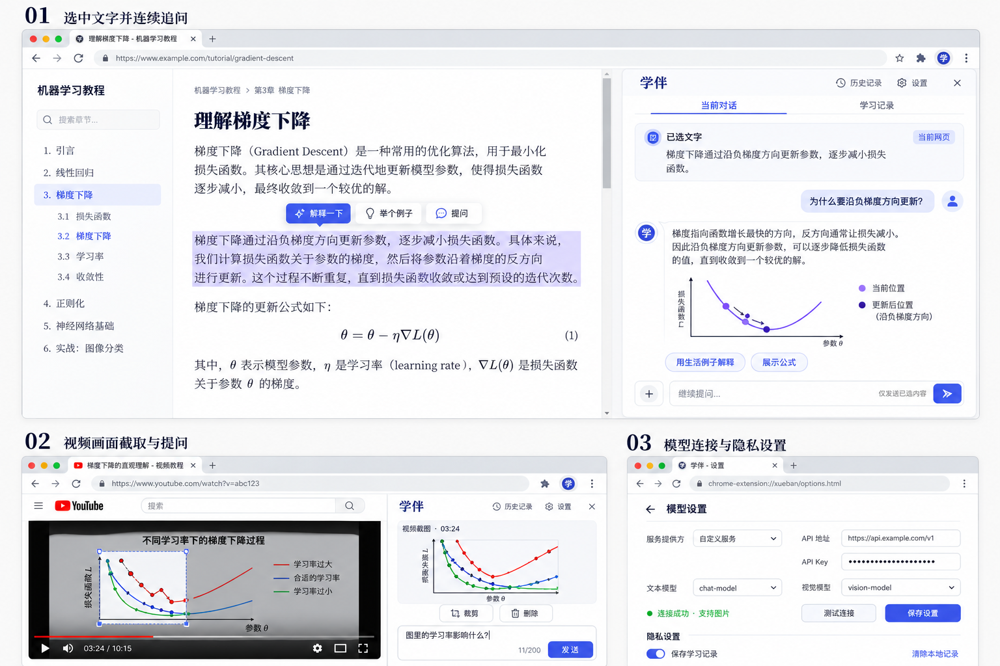

# 学伴 · 浏览器学习助手

在教程页面中选取文字、图片或视频画面，随时提问、连续追问，并结合网页上下文或联网资料理解知识。

学伴将学习材料、资料检索和模型问答放在浏览器侧栏中。你可以使用自己的在线模型 API，也可以连接 Ollama、LM Studio 等本地模型服务；发送前检查将被引用的文字和图片，回答后回到来源核对。

**当前版本：0.4.0** · 原生 JavaScript · Manifest V3 · 在线 / 本地模型

## 功能概览

| 功能 | 说明 |
| --- | --- |
| 划词提问 | 选中文字后解释、举例或提出自定义问题，支持右键入口 |
| 图片与视频截图 | 框选网页可见区域，将画面作为提问素材 |
| 网页上下文 | 检索当前网页的正文、代码、表格、图注及相关图片 |
| 联网搜索 | 查找新资料，预览搜索来源后再交给模型回答 |
| 来源引用 | 查看引用文字和图片，定位网页原文或打开外部来源 |
| 在线与本地模型 | 支持 OpenAI 兼容接口、Anthropic Messages、Ollama 和 LM Studio |
| 独立视觉连接 | 文本模型与视觉模型可分别配置协议、地址和 Key |
| 连续问答 | 流式回答、停止生成、复制与追问 |
| Markdown 与公式 | 支持标题、列表、表格、代码块及 KaTeX 数学公式 |
| 学习记录 | 本地搜索、恢复、删除记录，并导出 Markdown |

## 界面预览



上图为初始界面概念图。仓库中的 `preview/` 提供新版图文上下文、本地模型与联网搜索的界面示意，使用示例资料，不调用真实模型。

运行本地预览：

```bash
npm ci
npm run preview
```

打开 `http://127.0.0.1:8765`，结束后使用 `Ctrl+C` 停止。

## 安装

### Chrome / Edge

直接加载扩展不需要 Node.js 或后端服务器。

1. 克隆或下载本仓库并解压。
2. 在 Chrome 打开 `chrome://extensions`，或在 Edge 打开 `edge://extensions`。
3. 开启开发者模式，选择“加载已解压的扩展”。
4. 选择仓库中的 **`extension/` 目录**，该目录应直接包含 `manifest.json`。
5. 将学伴固定到工具栏，在教程网页上点击图标，打开侧栏并启用当前页工具。
6. 在设置中配置模型服务，测试连接并保存。

如果使用已构建的 Chromium ZIP，先解压，再加载直接包含 `manifest.json` 的目录。

### Firefox

Firefox 当前提供适配测试构建。准备开发环境后运行：

```bash
npm ci
npm run build
```

打开 `about:debugging#/runtime/this-firefox`，选择“临时载入附加组件”，加载 `dist/firefox/manifest.json`。临时安装在浏览器重启后失效，长期安装需要签名。

### 更新已有安装

保持安装目录路径不变，更新文件后关闭侧栏，在扩展管理页重新加载。重要记录建议先导出；直接卸载可能导致本地数据丢失。

## 配置模型

### 在线服务

选择服务对应的接口协议，填写基础地址、API Key 和准确的模型名称。模型基础地址不要包含末尾的 `/chat/completions` 或 `/messages`，插件会按协议拼接请求路径。

OpenAI 兼容接口不代表所有服务都具有完全相同的行为，需要通过连接测试确认。

### 本地服务

| 服务 | 协议 | 默认基础地址 |
| --- | --- | --- |
| Ollama | Ollama 原生接口 | `http://127.0.0.1:11434` |
| LM Studio | LM Studio 兼容接口 | `http://127.0.0.1:1234/v1` |
| 其他本地推理服务 | OpenAI 兼容接口 | 按服务实际配置填写 |

先启动对应服务并准备模型，再在扩展中使用本机预设、读取模型列表或手动填写模型名称。无鉴权的本地服务可以不填 Key；实际端口以服务设置为准。

插件不会安装推理软件、下载模型或启动推理服务。本地 HTTP 连接目前仅允许 `localhost` 和 `127.0.0.1`；其他服务地址需使用 HTTPS。

### 文本与视觉模型

纯文字请求使用文本模型；请求中包含图片时使用视觉模型，包括历史对话中保留的图片。

默认两者共用连接配置。开启“视觉模型使用独立服务地址与 Key”，可以组合本地文本模型与在线视觉模型，或分别连接两个本地服务。

使用“测试文本连接”检查文本响应，使用“测试图片能力”检查模型是否能描述白底红色方块。模型列表和请求成功状态不能单独证明视觉能力。

更完整的配置与排障说明见 [本地模型与联网搜索](docs/LOCAL_AND_SEARCH.md)。

## 使用方法

### 选取素材提问

1. 在当前网页点击学伴工具栏图标。
2. 划选文字后使用“解释一下”“举个例子”或“提问”，也可以使用右键菜单。
3. 检查侧栏中的素材卡片，输入问题并发送。
4. 继续输入问题即可追问，支持 `Ctrl+Enter` / `Command+Enter` 发送。

图片和视频画面可通过“截图素材”框选。拖动选区后松开确认，`Esc` 取消；视频建议先暂停。此操作仅提供所选画面，不读取整段视频或音轨。

### 结合当前网页

开启“结合当前网页”，点击“检索并预览”。插件先在本地读取并检索正文，将相关文字和图片列入预览。

- 文字片段可以展开检查和取消。
- 网页图片按替代文字、图注和周围正文推荐，也可以从候选中补选。
- 只发送勾选且成功生成预览的图片，每轮最多三张。
- 原图读取受限时，可以明确授权图片域名，或定位后截图。
- 检查完成后点击“确认发送”，才会把所选资料交给模型。

短页面可能在预算内整体使用有效正文；长页面使用关键词检索、变量名加权与相邻片段补充。长页面总结采用跨章节代表片段，并提示覆盖范围。

对话会绑定来源网页。网页变化后需要重新预览，切换网页时需要返回来源页或开始新对话。

### 联网搜索

在设置中配置 Tavily Search 请求地址与独立搜索 Key，然后开启“联网搜索”：

1. 检查或修改搜索词。
2. 点击“搜索并预览”，获取资料。
3. 核对来源标题、域名、正文摘录或搜索摘要，以及日期信息。
4. 取消不需要的结果，确认后再发送给模型。

默认请求地址为 `https://api.tavily.com/search`，这是完整搜索请求地址，不能替换为普通搜索网站首页。支持兼容同一协议的代理，可选时间范围和限定域名。

搜索与模型推理独立：本地模型也能结合搜索结果回答，但搜索词仍会发送给搜索服务。搜索不会自动附带选区或整页正文。搜索失败时保留问题并提示，不会继续声称已获取最新资料。

联网搜索与网页上下文可以同时开启。发布时间缺失时会明确标注，检索时间不能当作发布时间。

### 核对来源与保存记录

回答中的“来源 N”可以打开引用详情：网页来源可定位并高亮，联网来源可查看摘录并打开原网页。用户消息下也能查看全部已发送参考资料。

学习记录保存在本地，可搜索、恢复、逐条删除或全部清除。关闭记录保存不会自动清除已有内容。

复制与 Markdown 导出保留公式源码、回答和引用信息。图片保存在本地记录中，当前导出不生成独立图片附件。

## 数据与隐私

- 模型请求直接发送至配置的模型服务，项目没有自建聊天中转或内置遥测。
- API Key 默认保存在浏览器会话中；选择记住后存于扩展本地存储，未加密、不同步。
- 开启记录保存后，问题、回答、已发送引用和图片可保存在本地 IndexedDB。
- 联网搜索会向搜索服务发送搜索词；使用本地模型不意味着搜索也留在本机。
- 图片跨域下载不附带 Cookie、不跟随重定向；需要权限时由用户明确授权。
- 网页资料和模型输出按不可信内容处理，Markdown 清洗后渲染，公式禁用可信命令。

引用便于核对来源，但不能保证模型解释正确。外部模型和搜索服务各自的数据政策另行适用。

详见 [隐私说明](PRIVACY.md) 和 [安全问题报告](SECURITY.md)。

## 浏览器权限

| 权限 | 用途 |
| --- | --- |
| `activeTab` | 用户启用后的临时页面访问与截图 |
| `scripting` | 划词、正文提取、图片读取与来源定位 |
| `storage` | 配置、凭据保存选项与临时素材 |
| `contextMenus` | 文字和图片右键入口 |
| `sidePanel` | Chromium 侧栏；Firefox 使用独立侧栏接口 |
| 可选域名权限 | 模型和搜索 API，以及明确授权读取的原图域名 |

## 开发

开发工具链要求 **Node.js 24.15+ 的 24.x 版本**，版本提示见 `.nvmrc`。扩展使用原生 JavaScript ES Modules、HTML 和 CSS，无 React 构建步骤。

```bash
npm ci
npm run check
npm test
npm run package
```

| 命令 | 作用 |
| --- | --- |
| `npm run check` | 检查 JavaScript 语法、版本、Manifest 与资源引用 |
| `npm test` | 运行八组模型、渲染、检索、图像及联网流程测试 |
| `npm run build` | 生成 `dist/chromium/` 和 `dist/firefox/` |
| `npm run package` | 生成浏览器 ZIP 与 SHA-256 校验文件 |
| `npm run preview` | 启动本机示例界面预览 |
| `npm run preview:build` | 重新生成图文上下文示例页面 |
| `npm run vendor:sync` | 同步锁定版本的渲染依赖与许可证 |

Marked、DOMPurify 和 KaTeX 的脚本、样式及字体在扩展内本地打包，不依赖运行时 CDN。依赖版本通过 `package-lock.json` 固定。

### 项目结构

```text
extension/                 扩展源码，可直接加载 Chromium 版本
  background.js            工具栏、右键菜单、消息与截图
  content.js               划词及框选截图
  context-page.js          网页图文提取与来源定位
  context.js               文字检索及引用
  image-context.js         图片排序、下载与压缩
  page-images-ui.js        图片预览与选择
  web-search.js            搜索请求、结果整理与提示词
  profiles.js              模型连接与列表
  settings-ui.js           设置表单与凭据兼容
  panel.js                 对话、设置、记录与发送流程
  llm.js                   在线接口、Ollama 与流式响应
  render.js                Markdown、清洗与公式渲染
  vendor/                  本地渲染库与许可证
manifests/                 浏览器差异配置
tests/                     自动化测试
fixtures/                  测试样本
preview/                   示例界面
scripts/                   检查、构建、打包与预览
docs/                      配置、设计、测试与发布文档
.github/                   CI、Issue 和 PR 模板
```

### 测试与兼容范围

自动化测试使用 jsdom、模拟浏览器接口和模型响应替身，不需要真实 Key。覆盖协议转换、流式分块、公式排版、HTML 清洗、正文检索、来源编号、图片预算、授权流程、配置兼容及搜索预览。

| 浏览器 | 状态 |
| --- | --- |
| Edge / Chrome | 提供可加载的 Manifest V3 构建 |
| Firefox | 提供未签名的适配测试构建 |
| Safari | 暂未支持 |

真实浏览器权限、网站结构、模型服务和本地推理软件仍需单独验证。验收清单见 [测试说明](docs/TESTING.md)，构建与分发见 [发布说明](docs/RELEASING.md)。

## 已知限制与排障

| 情况 | 处理方式 |
| --- | --- |
| 刷新后没有划词工具条 | 重新点击工具栏图标启用当前页 |
| 图片回答提示不可见 | 核对素材预览、视觉模型与红色方块测试 |
| 原图读取失败 | 检查域名授权，或使用截图；登录和防盗链可能限制下载 |
| 没有相关网页图片 | 展开候选手动补选；无图注图片可能不被推荐 |
| 本地模型连接失败 | 检查服务是否启动、基础地址、端口、模型名及服务端来源限制 |
| 搜索失败或没有结果 | 检查独立搜索 Key、额度、时间范围及限定域名 |
| 来源无法定位 | 原页面可能已关闭或改变，仍可查看保存的引用 |
| 公式仍显示源码 | 代码块、未闭合或不受支持的公式会保留原文 |
| API 返回 401 / 403 / 404 / 429 | 检查凭据、权限、地址、模型名、额度及限流 |
| 关闭侧栏后生成中断 | 当前请求运行在侧栏；已保存记录可恢复 |

默认每轮网页文字引用约 14,000 字符，搜索资料约 12,000 字符。网页图片最多三张，最长边优先缩放到 1600px，每张 PNG 约 1.5 MB 上限。完整限制见配置文档；长对话仍可能超出模型容量。

暂不支持音频片段、视频片段理解、自动字幕读取、CSS 背景图或跨域 iframe 图文采集，也没有独立裁剪编辑器。浏览器内部页、商店页、部分 PDF 阅读器和受保护视频受到平台限制。

## 参与贡献

欢迎反馈使用问题、改进建议与代码修改。提交问题时请说明插件版本、浏览器、模型服务和脱敏复现步骤，不要公开真实 Key 或私人学习资料。

贡献流程见 [CONTRIBUTING.md](CONTRIBUTING.md)，版本变化见 [CHANGELOG.md](CHANGELOG.md)。

## 许可证

项目采用 [MIT License](LICENSE)。第三方库保留各自许可证，详见 [THIRD_PARTY_NOTICES.md](THIRD_PARTY_NOTICES.md)。
